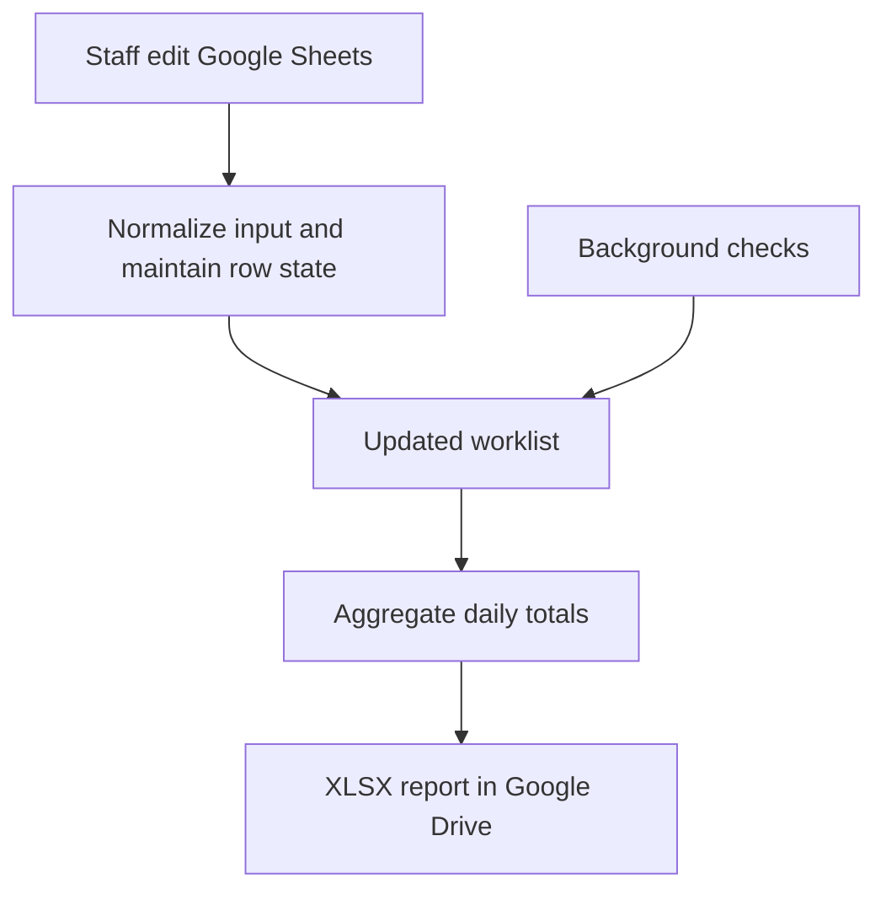
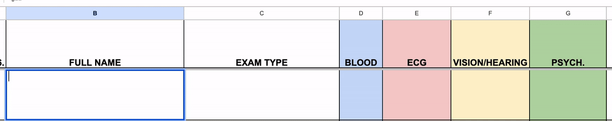

# Spreadsheet Workflow Automation

**Turning a clinic's existing Google Sheet into a coordinated daily workflow.**

## The problem and idea

Staff already used a spreadsheet for intake and daily worklists. Inconsistent entries, manual waiting-time checks and end-of-day counting created repetitive administrative work. I built a volunteer automation project around that familiar tool, so staff could keep their existing workflow while routine steps happened automatically.

## How it works

Google Apps Script standardizes entries, timestamps cases and maintains persistent row state. Background jobs flag waiting cases and prepare the next workday. Reporting counts the relevant exam categories and saves an XLSX file to Google Drive. Locks and a deferred edit queue coordinate simultaneous edits and background work.

The implementation uses 27 Apps Script modules and separate HTML dialogs for configuration, announcements and reporting. My work covered workflow mapping, requirements, implementation, testing and integration, with AI assistance for programming.

## See it in action

*Fictional entries demonstrate timestamping, correction of a misspelled exam type and automatic helper fields.*

The [demo guide](docs/DEMO_ASSETS.md) also shows background waiting warnings and report export. All demonstrations use synthetic data.

## Explore the implementation

- [Technical reference](docs/TECHNICAL_REFERENCE.md) — workflow, detailed architecture diagram, row identity, locking and module guide.
- [Setup](docs/SETUP.md) and [troubleshooting](docs/TROUBLESHOOTING.md) — configuration, triggers and runtime requirements.
- [Source](src/) — Apps Script modules and HTML interfaces.

## Current scope

This is the public, cleaned version of a real administrative automation project. It is tied to a particular spreadsheet layout and needs configuration before reuse. It supports operational worklists and reporting; it is not a diagnostic or clinical decision system. Patient records, clinic configuration, credentials and deployment identifiers are excluded.

MIT — see [LICENSE](LICENSE).
